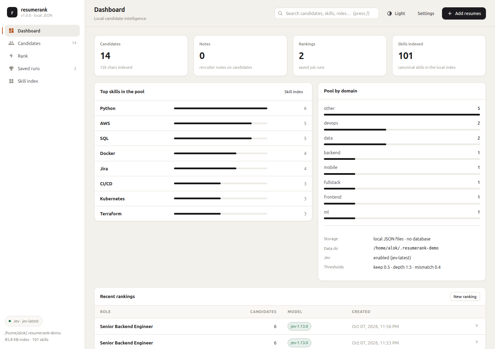
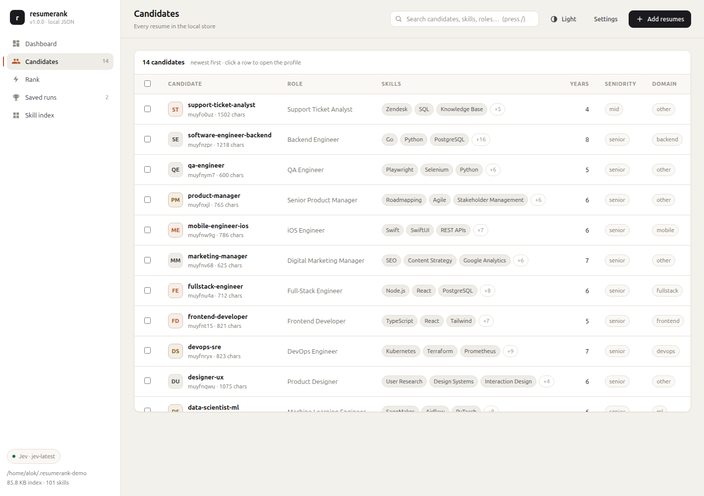
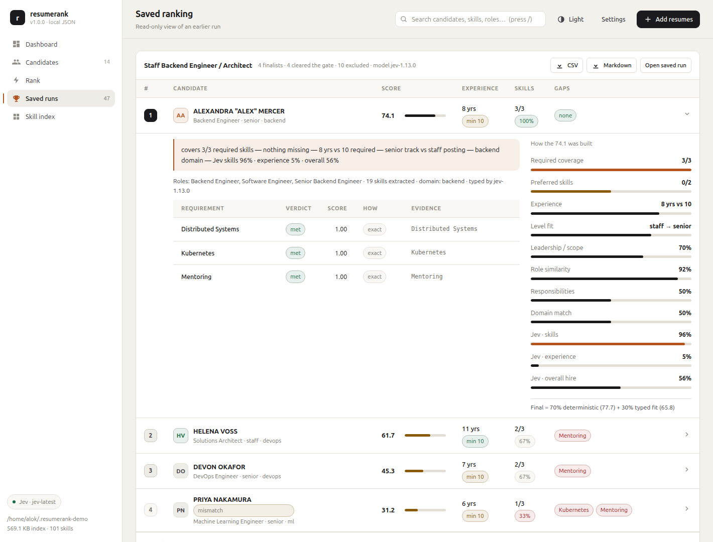
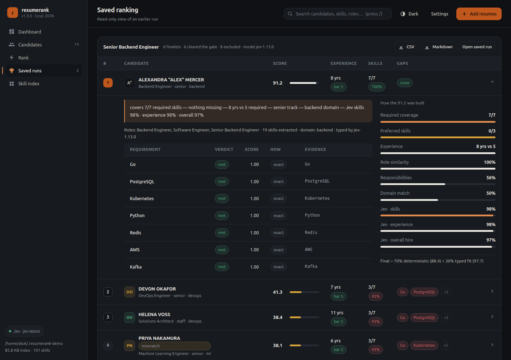

# resumerank

> [!WARNING]
> **This repository is fully managed by the HERMS agent.** All commits, changes and
> releases are produced automatically by the agent. Do not rely on the history or the
> state of this repo as a stable reference.
>
> **This project is experimental** — in particular its integration with
> [TypeSafe Jev](https://typesafe.ai). Expect breaking changes, rough edges and
> incomplete features. Use at your own risk.

**Rank a pile of resumes against a job description, locally.** A point-and-click
web app, one self-contained HTML report, and a scriptable CLI — no database, no
account, nothing leaving your machine.

### Two ways to use it (pick the one that suits the person)

| for | how to start | what it is |
| --- | --- | --- |
| **anyone, no terminal** | `resumerank ui` — or the **resumerank** icon in the applications menu | the web app: drag in resumes, paste a job description, click Rank, read the shortlist |
| **sharing / printing** | `resumerank dashboard` | one self-contained `.html` file (no server, opens by double-click, emailable) |
| **scripts and shells** | `resumerank dash` (terminal dashboard) or the hidden CLI verbs below | same engine, scriptable |


Every resume, ranking and note lives in plain JSON under `~/.resumerank`. The only
optional cloud piece is [TypeSafe Jev](https://typesafe.ai) — a typed-question API
that confirms what was extracted. Add a key in **Settings** for the most accurate
mode, or use it with no key at all and it still works, fully offline.

```
                                                ┌─ deterministic proposers (dictionary + regex + context)
PDF / DOCX / TXT  ─►  text  ─►  sections  ─►   │
                                                └─ typed Jev answers (only if you add a key)
                                                          │
JD text  ─►  requirements  ─►  semantic matching  ─►  weighted score  ─►  level fit  ─►  ranked shortlist
                                                          │
                                          ranked list + a "why this rank" panel per candidate
```

- **Offline by design.** No key, or `--offline`, or `RESUMERANK_OFFLINE=1` → zero
  network calls. The deterministic layer is the recall engine; Jev is the precision
  engine and always fails open.
- **Semantic, not keyword.** The ontology knows `AWS` is satisfied by `S3`/`Lambda`/`EKS`,
  that `Kubernetes` is satisfied by `EKS`, that `SQL` is satisfied by `MySQL`.
- **Seniority-aware.** A junior posting will not shortlist an 8-year senior, and a
  staff posting looks for leadership evidence — with the reasoning shown per candidate.
- **Auditable.** Every skill carries the typed answer that kept it; every rank shows
  each scoring component and the requirement-by-requirement evidence.
- **No database.** A JSON index plus an inverted skill index: 0.1 ms skill lookups,
  ~13 ms to rank a 14-resume pool.

## Screenshots

| Dashboard | Candidates |
| --- | --- |
|  |  |

**Why this rank** — every candidate expands into the components, the typed reads and the per-requirement evidence:



<details>
<summary>Dark theme</summary>



</details>

## Install

One line (needs Node.js 20+; installs to `~/.resumerank-app`, launcher in `~/.local/bin`):

```bash
curl -fsSL https://raw.githubusercontent.com/alok-mishra143/resumerank/main/install.sh | bash
```

Then:

```bash
resumerank ui          # opens the local web UI at http://127.0.0.1:7777
```

Useful installer switches (all optional):

```bash
RESUMERANK_DIR=~/apps/resumerank \
RESUMERANK_BIN=~/.local/bin \
RESUMERANK_REF=v1.0.0 \
  bash install.sh
```

### Opening it like an app

`install.sh` also drops a **resumerank** entry and icon into your applications menu
(`~/.local/share/applications/resumerank.desktop`, icon in `~/.local/share/icons`),
so the app can be started by clicking instead of typing. It runs `resumerank ui`,
which serves on `127.0.0.1` and opens your browser.

### Manual install

```bash
git clone https://github.com/alok-mishra143/resumerank
cd resumerank
./resumerank ui               # installs the runtime deps on first run, then starts the UI
```

`./resumerank` is a tiny launcher: it checks your Node version, installs the
runtime dependencies once (they are not committed) and runs the prebuilt bundle.
It works the same from an unzipped release. If you prefer to do it by hand:

```bash
npm install --omit=dev        # the repo ships a prebuilt bundle, so no build is needed
node dist/resumerank.js ui
```

### From source, with tests

```bash
npm install
npm run build        # bundles dist/resumerank.js
npm test             # 89 tests
npm run typecheck
```

## Quickstart

```bash
# the normal way in: opens the web app in your browser
resumerank ui

# or write a dashboard you can keep, email or print
resumerank dashboard --open

# everything below is the same engine from the shell
resumerank add ~/resumes/*.pdf

# see what was extracted, and why
resumerank list
resumerank show <resumeId> --provenance

# rank everyone against a job description
resumerank rank --title "Senior Backend Engineer" --jd job.md
resumerank show-ranking <rankingId>
resumerank export <rankingId> --out ./reports --md

# why did this one score 71?
resumerank explain <resumeId> --title "Senior Backend Engineer" --jd job.md

# the web UI again, any time
resumerank ui
```

## Adding your TypeSafe (Jev) key

Open the UI → **Settings** → *TypeSafe Jev key* → paste the key → **Save** →
**Test connection**. The key is written to `~/.resumerank/config.json` with `0600`
permissions, used immediately, and never sent back to the browser (the UI only
ever sees a status and the last four characters).

You can also set it in the environment, which takes precedence:

```bash
export TYPESAFE_API_KEY=ts_...
resumerank doctor      # confirms the key, prints the model and a ping probability
```

Without a key: extraction, matching, ranking, the UI and every export still work.
`doctor` and the UI both say so plainly instead of failing.

## Features

**Web UI** (no framework, no build step — one HTML file, one stylesheet, one script)

- **Dashboard** — pool size, top skills with proportional bars, domain breakdown, storage and key status.
- **Candidates** — search (`/` to focus), multi-select bulk delete, confidence and notes columns.
- **Mass upload** — drag a whole folder in; files are read in the browser and POSTed in
  batches with a per-file result, optionally with extraction forced offline.
- **Candidate profile** — contact, seniority, domain, education split into
  degree/field/school/years, the parsed **experience timeline**, skill cards showing
  the evidence behind each skill, rejected mentions for audit, raw text, original file
  download, and **notes** (add/edit/delete, stored locally).
- **Rank** — paste or drop a JD, preview the parsed requirements (including the
  inferred **seniority band**) before spending a single call, then get finalists with
  score bars, experience-vs-bar, required-skill coverage, gaps, the *why this rank*
  panel, the excluded list with reasons, and CSV/Markdown/JSON export.
- **Saved runs** and a **Skill index** (canonical skill → candidates, with a filter).
- Light and dark themes, following your OS, with a pre-paint switch (`/?theme=dark#/candidates`).

**Terminal dashboard** — the whole app without a browser (`resumerank dash`, alias `tui`):

```
┌──────────────────────────────────────────────────────────────────────────────────────────────┐
│  resumerank 1.0.0  14 resumes · 101 skills · 50 rankings              ● enabled (jev-latest) │
│ [1 Overview]  2 Candidates   3 Rankings   4 Help                                 / to filter │
├──────────────────────────────────────────────────────────────────────────────────────────────┤
│ Store                                                                                        │
│   data dir     /home/alok/.resumerank-demo                                                   │
│   candidates   14    skills 101    notes 0    index 639 KB                                   │
│   typed layer  enabled (jev-latest)    cached answers 99                                     │
│                                                                                              │
│ Top skills in the pool                                                                       │
│   Python                 ██████████████ 6                                                    │
│   AWS                    ████████████░░ 5                                                    │
│   SQL                    ████████████░░ 5                                                    │
│   Docker                 █████████░░░░░ 4                                                    │
│   Jira                   █████████░░░░░ 4                                                    │
│   CI/CD                  ███████░░░░░░░ 3                                                    │
│   Kubernetes             ███████░░░░░░░ 3                                                    │
│   Terraform              ███████░░░░░░░ 3                                                    │
│                                                                                              │
│ Recent rankings                                                                              │
│   rk_muzs3sed Senior Backend Engineer              5 scored · offline                        │
│   rk_muykx3ju Senior Backend Engineer              7 scored · offline                        │
│   rk_muykx3a5 Senior Backend Engineer              7 scored · offline                        │
│                                                                                              │
├──────────────────────────────────────────────────────────────────────────────────────────────┤
│ j/k move · enter open · / filter · r rank · o browser · q quit                               │
```

Keys: `1`–`4` switch views, `j`/`k` (or arrows) move, `enter` opens a candidate,
`/` filters, `r` ranks the pool against a job description file, `o` starts the web
UI on the same store, `q` quits. It draws its own frame and restores the terminal on
exit; when stdin is not a terminal (or with `--snapshot`) it prints one frame and
exits, so it is scriptable and screenshot-testable.

**CLI** — five commands, because the audience uses the app, not a shell:

| command | what it does |
| --- | --- |
| `ui` (`web`) | the local web app — resumes, ranking, notes, settings. **Start here.** |
| `dashboard` (`report`) | write a self-contained HTML dashboard (`--out FILE`, `--open`) — no server needed |
| `dash` (`tui`) | terminal dashboard: pool, saved runs, ranking runs (`--snapshot` for one plain frame) |
| `init` | create the data directory and optionally store a key |
| `uninstall` | remove the app, launcher and menu entry (`--dry-run` to preview, `--purge` to also delete your data) |

Everything else is a **hidden** scripting verb: still fully functional (your scripts
and the accuracy harness keep working) but left out of `--help` so the list stays
readable —

`add`, `list`, `show`, `remove`, `rank`, `explain`, `rankings`, `show-ranking`,
`export`, `rm-ranking`, `status`, `skills`, `cache`, `doctor`, `eval`, `notes`,
`note`, `rm-note`, `version`.

```bash
resumerank add ~/resumes/*.pdf                              # hidden, scriptable
resumerank rank --title "Senior Backend Engineer" --jd job.md
resumerank eval --corpus corpus --offline                   # accuracy harness
```

### Uninstalling

```bash
resumerank uninstall --dry-run     # show exactly what would be removed
resumerank uninstall               # asks first; keeps your resume data
resumerank uninstall --purge       # also deletes ~/.resumerank (resumes, rankings, notes, key)
```

It removes the launcher, the applications-menu entry, the icon and the program
files — and only the program files: a source checkout (no installer marker) is left
untouched, a launcher that belongs to something else is left alone, and your data
survives unless you pass `--purge`. Every candidate is listed with the reason.

Global flags: `--data-dir <dir>`, `--offline`, `--verbose`.

## How ranking works

1. **JD requirements** — sections, bullets and one-line lists ("Requirements: Go,
   Kubernetes. Nice to have: Terraform"), ontology expansion, must-have language, then
   the posting's seniority band from its title and years bar.
2. **Semantic matching** per requirement: exact/alias 1.0, a specific service of the
   requirement 1.0, a narrower requirement than the candidate's skill 0.8, lexical
   fallback for unknown skills, typed Jev probability for the remainder. Coverage is
   the mean graded match, so partial credit is visible.
3. **Weighted score** — required skills 30, experience 15, role similarity 13,
   responsibilities 13, level fit 16, domain 8, preferred 5, leadership 12 (only
   counted when the posting asks for it), all configurable via `RANKING_WEIGHTS`.
4. **Mismatch gate** — cross-field candidates (coverage < 15%) are dropped and listed
   with reasons; everything else is kept and flagged rather than hidden.
5. **Typed fit battery** — one batched HTTP call asking three `noul` questions per
   candidate (skills, experience, credible hire) for the finalists.
6. **Blend** — 70% deterministic + 30% typed fit by default (`RANKING_DETERMINISTIC_WEIGHT`).
7. **Level fit** — an explicit 4×4 matrix compares the posting's band with the
   candidate's. Under-qualification is always penalised; over-qualification only where
   it hurts (a staff engineer answering a senior req scores 1.0, a senior answering a
   junior req 0.35). Entry-level postings exclude candidates two bands above.

## Accuracy and performance

Measured, with raw output in `docs/accuracy-jev.txt`, `docs/accuracy-offline.txt`
and a full write-up in **[docs/report.md](docs/report.md)**.

Gold-labelled corpus (14 resumes × 5 job descriptions, hand-labelled):

| metric | offline | with Jev |
| --- | --- | --- |
| skill precision / recall / F1 | 91.2% / 100% / 95.0% | **95.2% / 100% / 97.3%** |
| years of experience (±1y) | 100% | 100% |
| JD requirement F1 | 93.1% | 93.1% |
| top-1 eligible | 100% | 100% |
| eligible in top-3 | 100% | **100%** |
| false accepts (ineligible in top-3) | 0% | 0% |
| **composite** | **98.2%** | **98.8%** |

On 18 real resumes downloaded from the web, every extracted value is checked against
the source text (an unsupported value counts as a failure): **96.3% grounded** —
email, phone, name, location, skills and role start years are 100% traceable, i.e.
nothing is invented.

### How much can you trust a ranking?

- **It never invents experience.** Every requirement credited to a candidate carries
  its provenance in the UI and the JSON: `exact`, `alias`, `specific`
  ("S3 ⇒ AWS"), `platform` (only real platform→service pairs), `lexical`, or
  `jev P=0.78`. On the real-resume pool, 28/29 and 25/31 credited skills in the
  top-5 of two real job descriptions are literally in the CV; the rest are typed
  answers with the model's probability shown, and none were unsupported.
- **It is reproducible.** The same pool and job description rank identically on
  every run — offline 5/5 runs byte-identical, and with Jev 5/5 after the answer
  cache (the model alone varied run to run, which is exactly why the cache exists).
- **The decision is not a coin flip.** Rank-1 beats rank-2 by 6.7–48.5 points
  across the gold set. Ties are worth reading by hand, and the UI shows the
  component scores so you can see why.
- **It says no.** Coverage below 40% is flagged, three seniority bands away is
  excluded, out-of-domain candidates are labelled, and `false accepts` has stayed
  at 0% throughout.

### Performance

| what | before | now |
| --- | --- | --- |
| rank 14 candidates, offline (warm) | 12–13 ms | **3.2–4.8 ms** |
| deterministic scoring per pool | 7.5 ms | 1.1 ms |
| re-rank the same job with Jev | 6.1 s · 15 calls | **98 ms · 0 calls** |
| ingest 8 real PDFs with Jev | 14.6 s | **5.1 s** |
| bulk upload 8 PDFs in the UI | 15.0 s | **3.3–4.1 s** |
| re-ingest a resume already in the library | 4 calls | 0 calls |
| CLI cold start | 0.24 s | 0.24 s |

Ingest is parallel (`RESUMERANK_INGEST_LANES`, default 4 with a key); typed answers
are cached in `~/.resumerank/jev-cache.json` (`resumerank cache` to inspect or
clear, `RESUMERANK_FRESH=1` to ignore it). Skill lookup 0.1 ms, 5 runtime
dependencies.

## Privacy

- Resumes never leave your machine unless you add a TypeSafe key, and even then only
  compact structured summaries plus a 2,500-character excerpt are sent for those calls.
- The key is stored locally with `0600` permissions and is never returned by the API.
- The web UI binds `127.0.0.1` only — it is not reachable from your network.
- Notes, rankings and extracted profiles are plain files you can read, copy or delete.

## Development

```bash
npm test                 # 101 tests: ontology, matching, extraction, layouts, seniority, store, dashboards, CLI, UI API
npm run typecheck
npm run eval             # accuracy with the typed layer
npm run eval:offline     # accuracy with zero network calls
npm run build            # dist/resumerank.js
npx tsx tools/bench.ts   # performance numbers
npx tsx tools/verify-real.ts    # grounded-value check on the resumes you have
npx tsx tools/audit-extraction.ts   # per-field coverage for a store
```

Architecture and design notes: `docs/jev-notes.md` (the TypeSafe contract, every
question battery, and the bugs real resumes exposed), `docs/accuracy.md` (how to
reproduce), `docs/report.md` (accuracy, performance, robustness).

Repository layout:

```
src/
  cli/            command surface, formatting, exports
  ui/             node:http server + the framework-free app (app/)
  extract/        deterministic proposers, ontology, text sections, extraction pipeline
  ranking/        JD parsing, semantic matching, scoring, ranking service
  ai/             the TypeSafe Jev client (typed questions, batching, retries)
  store/          JSON store, inverted index, notes
  eval/           accuracy harness
tools/            benchmark, audit, verification and debug probes
corpus/           14 labelled resumes + 5 job descriptions + gold.json
test/             101 tests
install.sh        curl-able installer
resumerank        launcher for a checkout or unzipped release
```

## License

MIT — see [LICENSE](LICENSE).

Resumes in `corpus/` are synthetic. The third-party PDFs used for the real-resume
verification are not redistributed.
